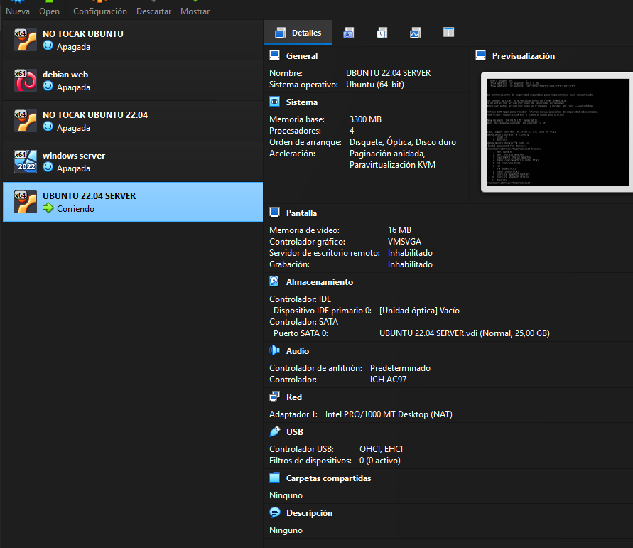
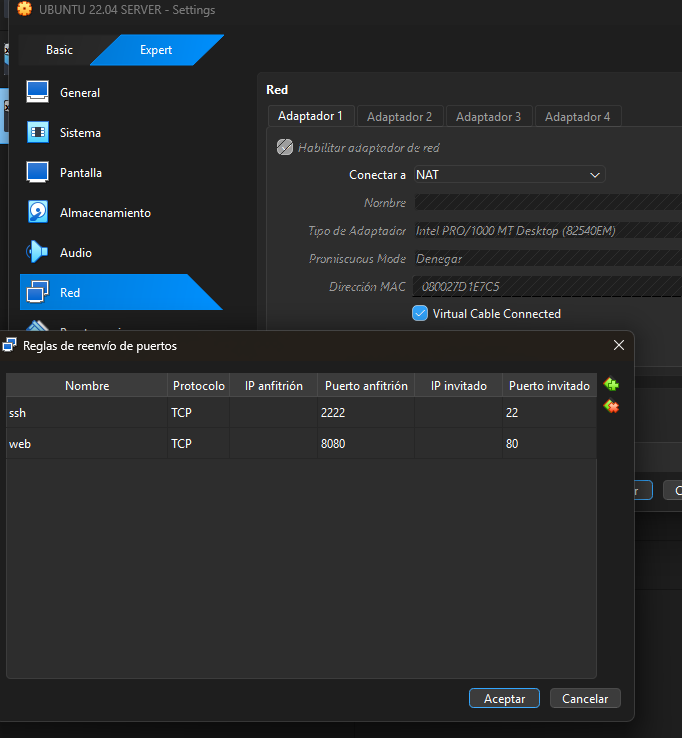

# lab-servidor-web

# Laboratorio: 
Servidor web con Apache en VirtualBox

## Objetivo: 
Levantar un servidor de Apache con una maquina Ubuntu Server 22.04 y hacer una prueba de que funciona

## Requisitos: VirtualBox, ISO de Ubuntu Server 22.04 y Sistema operativo Windows 11 (ejemplo)

## Pasos: 
1. Creación de la maquina
 
   
2. Configuración de red y reenvío de puertos
 
3. Instalación de Apache
   
4. Comprobación desde el navegador
 

